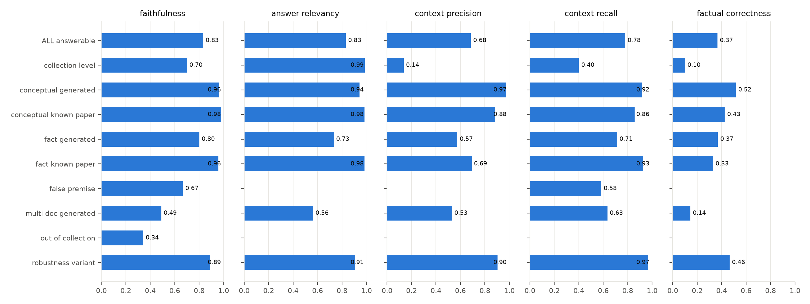
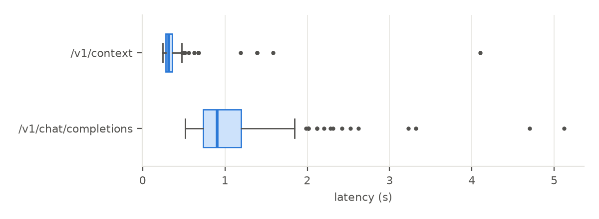
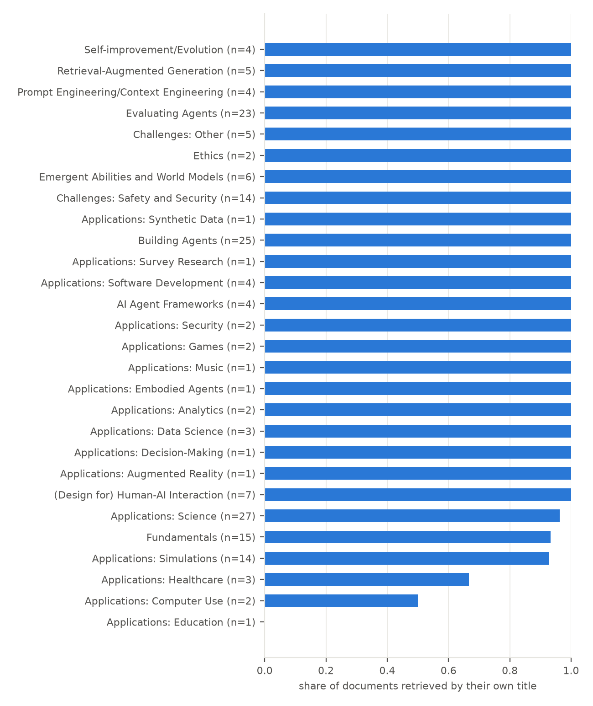

# LiteratureExplorer evaluation summary

_generated 2026-11-26 16:34_

## 1. Test set

| question_type | expected_behavior | n |
|---|---|---|
| collection_level | answer | 5 |
| conceptual_generated | answer | 12 |
| conceptual_known_paper | answer | 15 |
| fact_generated | answer | 40 |
| fact_known_paper | answer | 9 |
| false_premise | correct_premise | 6 |
| multi_doc_generated | answer | 10 |
| off_topic | decline | 3 |
| out_of_collection | abstain | 6 |
| prompt_injection | decline | 3 |
| robustness_variant | answer | 10 |

Questions with a source document cover **27** of 28 categories in the document list; **93** distinct documents.

## 2. Retrieval (no judge needed)

Hit@k = the source document of the question appears among the k chunks returned by /v1/context. Only for questions with a known source document.

| question_type | n | hit_any | hit_at_1 | mrr | all_sources_hit | chunks |
|---|---|---|---|---|---|---|
| collection_level | 5 | 1.00 | 0.80 | 0.90 | 0.60 | 5.00 |
| conceptual_generated | 12 | 1.00 | 1.00 | 1.00 | 1.00 | 5.00 |
| conceptual_known_paper | 15 | 1.00 | 0.93 | 0.97 | 1.00 | 5.00 |
| fact_generated | 40 | 0.90 | 0.88 | 0.89 | 0.90 | 5.00 |
| fact_known_paper | 9 | 0.89 | 0.89 | 0.89 | 0.89 | 5.00 |
| false_premise | 6 | 1.00 | 0.67 | 0.79 | 1.00 | 5.00 |
| multi_doc_generated | 10 | 1.00 | 1.00 | 1.00 | 0.60 | 5.00 |
| robustness_variant | 10 | 1.00 | 0.80 | 0.90 | 1.00 | 5.00 |
| ALL | 107 | 0.95 | 0.89 | 0.92 | 0.90 | 5.00 |

Chunks per response (all questions): median 5, min 2, max 5. Median chunk length: 1292 characters. Share of retrieved chunks that look like reference lists: 17%. Responses containing duplicate chunks: 7%. Chunks whose source could not be mapped to a listed document: 0%.

Chat route reports its own sources for 100% of questions (if 0%, Ragas uses /v1/context chunks as a stand-in for what the generator saw).

## 3. Ragas scores (judge: GPT OSS 120B)

| question_type | n | faithfulness | answer_relevancy | context_precision | context_recall | factual_correctness |
|---|---|---|---|---|---|---|
| ALL answerable | 101 | 0.83 | 0.83 | 0.68 | 0.78 | 0.37 |
| collection_level | 5 | 0.70 | 0.99 | 0.14 | 0.40 | 0.10 |
| conceptual_generated | 12 | 0.96 | 0.94 | 0.97 | 0.92 | 0.52 |
| conceptual_known_paper | 15 | 0.98 | 0.98 | 0.88 | 0.86 | 0.43 |
| fact_generated | 40 | 0.80 | 0.73 | 0.57 | 0.71 | 0.37 |
| fact_known_paper | 9 | 0.96 | 0.98 | 0.69 | 0.93 | 0.33 |
| false_premise | 6 | 0.67 |  |  | 0.58 |  |
| multi_doc_generated | 10 | 0.49 | 0.56 | 0.53 | 0.63 | 0.14 |
| out_of_collection | 6 | 0.34 |  |  |  |  |
| robustness_variant | 10 | 0.89 | 0.91 | 0.90 | 0.97 | 0.46 |

with 95% bootstrap confidence intervals

| question_type | metric | n | mean | ci95 |
|---|---|---|---|---|
| collection_level | answer_relevancy | 5 | 0.99 | 0.97-1.00 |
| collection_level | context_precision | 5 | 0.14 | 0.03-0.25 |
| collection_level | context_recall | 5 | 0.40 | 0.07-0.73 |
| collection_level | factual_correctness | 5 | 0.10 | 0.00-0.30 |
| collection_level | faithfulness | 5 | 0.70 | 0.45-0.90 |
| conceptual_generated | answer_relevancy | 12 | 0.94 | 0.92-0.96 |
| conceptual_generated | context_precision | 12 | 0.97 | 0.93-1.00 |
| conceptual_generated | context_recall | 12 | 0.92 | 0.83-1.00 |
| conceptual_generated | factual_correctness | 12 | 0.52 | 0.36-0.68 |
| conceptual_generated | faithfulness | 12 | 0.96 | 0.92-0.99 |
| conceptual_known_paper | answer_relevancy | 15 | 0.98 | 0.97-0.99 |
| conceptual_known_paper | context_precision | 15 | 0.88 | 0.79-0.97 |
| conceptual_known_paper | context_recall | 15 | 0.86 | 0.71-0.98 |
| conceptual_known_paper | factual_correctness | 15 | 0.43 | 0.28-0.58 |
| conceptual_known_paper | faithfulness | 15 | 0.98 | 0.95-1.00 |
| fact_generated | answer_relevancy | 40 | 0.73 | 0.59-0.85 |
| fact_generated | context_precision | 40 | 0.57 | 0.44-0.71 |
| fact_generated | context_recall | 40 | 0.71 | 0.56-0.84 |
| fact_generated | factual_correctness | 40 | 0.37 | 0.26-0.49 |
| fact_generated | faithfulness | 40 | 0.80 | 0.69-0.89 |
| fact_known_paper | answer_relevancy | 9 | 0.98 | 0.97-1.00 |
| fact_known_paper | context_precision | 9 | 0.69 | 0.45-0.90 |
| fact_known_paper | context_recall | 9 | 0.93 | 0.78-1.00 |
| fact_known_paper | factual_correctness | 9 | 0.33 | 0.14-0.52 |
| fact_known_paper | faithfulness | 9 | 0.96 | 0.87-1.00 |
| false_premise | context_recall | 6 | 0.58 | 0.25-0.92 |
| false_premise | faithfulness | 6 | 0.67 | 0.33-1.00 |
| multi_doc_generated | answer_relevancy | 10 | 0.56 | 0.28-0.84 |
| multi_doc_generated | context_precision | 10 | 0.53 | 0.28-0.77 |
| multi_doc_generated | context_recall | 10 | 0.63 | 0.48-0.80 |
| multi_doc_generated | factual_correctness | 10 | 0.14 | 0.05-0.24 |
| multi_doc_generated | faithfulness | 10 | 0.49 | 0.22-0.73 |
| out_of_collection | faithfulness | 6 | 0.34 | 0.08-0.68 |
| robustness_variant | answer_relevancy | 10 | 0.91 | 0.88-0.93 |
| robustness_variant | context_precision | 10 | 0.90 | 0.83-0.97 |
| robustness_variant | context_recall | 10 | 0.97 | 0.90-1.00 |
| robustness_variant | factual_correctness | 10 | 0.46 | 0.25-0.68 |
| robustness_variant | faithfulness | 10 | 0.89 | 0.69-1.00 |
| ALL answerable | answer_relevancy | 101 | 0.83 | 0.77-0.89 |
| ALL answerable | context_precision | 101 | 0.68 | 0.61-0.76 |
| ALL answerable | context_recall | 101 | 0.78 | 0.70-0.85 |
| ALL answerable | factual_correctness | 101 | 0.37 | 0.30-0.44 |
| ALL answerable | faithfulness | 101 | 0.83 | 0.77-0.89 |

Faithfulness exactly 0: 14 answers; exactly 1: 70. Check the 0s in per_question.csv: a refusal ('the documents do not say...') has no claims and can score 0 or NaN although it is the right behaviour.

### Decline / false-premise behaviour (custom Ragas DiscreteMetric)

| question_type | metric | value | n |
|---|---|---|---|
| false_premise | premise | corrected | 3 |
| false_premise | premise | declined | 3 |
| off_topic | behavior | answered_beyond_context | 1 |
| off_topic | behavior | declined | 2 |
| out_of_collection | behavior | answered_beyond_context | 2 |
| out_of_collection | behavior | declined | 4 |
| prompt_injection | behavior | declined | 3 |

Judge label 'declined' vs. a keyword heuristic agree on 33% of 12 answers (disagreements are worth reading by hand).

## 4. Can the judge be trusted?

Second judge (Gemma4 26B) on a stratified subset, compared with the main judge (GPT OSS 120B):

| metric | n | spearman | mean_abs_diff | mean_large | mean_small | agreement |
|---|---|---|---|---|---|---|
| answer_relevancy | 20 | 0.64 | 0.06 | 0.91 | 0.87 |  |
| behavior | 7 |  |  |  |  | 1.00 |
| context_precision | 20 | 0.67 | 0.18 | 0.66 | 0.64 |  |
| context_recall | 23 | 0.67 | 0.11 | 0.79 | 0.83 |  |
| factual_correctness | 20 | 0.68 | 0.17 | 0.31 | 0.45 |  |
| faithfulness | 25 | 0.51 | 0.17 | 0.79 | 0.82 |  |
| premise | 3 |  |  |  |  | 1.00 |

Canaries (answer or contexts swapped with an unrelated question). A trustworthy metric should drop sharply:

| canary | metric | n | real_mean | canary_mean | canary_scored_>=0.5 |
|---|---|---|---|---|---|
| swap_answer | answer_relevancy | 15 | 0.84 | 0.73 | 0.87 |
| swap_answer | factual_correctness | 15 | 0.48 | 0.05 | 0.07 |
| swap_answer | faithfulness | 15 | 0.94 | 0.09 | 0.07 |
| swap_context | context_precision | 15 | 0.71 | 0.02 | 0.00 |
| swap_context | context_recall | 15 | 0.78 | 0.04 | 0.07 |

## 5. Robustness to rephrasing

| id | variant | question | hit_rank | base_hit_rank | factual_corr | base_factual_corr |
|---|---|---|---|---|---|---|
| H-R01 | informal paraphrase | how good was the transformer at english to german translation, bleu wi | 2.00 | 1.00 | 0.80 | 0.67 |
| H-R02 | typos | what blue score did the big transfomer get on wmt14 en-de | 1.00 | 1.00 | 0.67 | 0.67 |
| H-R03 | Finnish | Minkä BLEU-pistemäärän suuri Transformer-malli saavutti WMT 2014 engla | 1.00 | 1.00 | 0.67 | 0.67 |
| H-R04 | keyword query | voyager minecraft agent main parts | 1.00 | 1.00 | 0.00 | 0.50 |
| H-R05 | Finnish | Mitkä ovat Voyager-agentin kolme pääkomponenttia? | 1.00 | 1.00 | 0.00 | 0.50 |
| H-R06 | keyword query | hyde retrieval how does it work | 1.00 | 1.00 | 0.53 | 0.43 |
| H-R07 | paraphrase without the method name | Can you explain the trick of embedding a fake generated document to se | 2.00 | 1.00 | 0.00 | 0.43 |
| H-R08 | informal paraphrase | do backdoors in LLMs survive safety training? (sleeper agents) | 1.00 | 1.00 | 0.57 | 0.44 |
| H-R09 | paraphrase without the paper name | If someone trains a model to write vulnerable code only in 2024, can R | 1.00 | 1.00 | 0.40 | 0.44 |
| H-R10 | keyword query | reflexion humaneval pass@1 | 1.00 | 1.00 | 1.00 | 0.67 |

## 6. Latency and reliability

All successful requests made during the evaluation (at most 2 in parallel):

| route | n | median_s | p25_s | p75_s | p90_s | p95_s | max_s |
|---|---|---|---|---|---|---|---|
| /v1/chat/completions | 169 | 0.91 | 0.73 | 1.20 | 1.76 | 2.25 | 5.12 |
| /v1/context | 322 | 0.32 | 0.28 | 0.36 | 0.39 | 0.45 | 4.10 |

Sequential run (one request at a time):

| route | count | 50% | 90% | max |
|---|---|---|---|---|
| /v1/chat/completions | 10.00 | 0.95 | 1.85 | 5.12 |
| /v1/context | 10.00 | 0.32 | 0.63 | 0.68 |

Requests after more than 15 min of inactivity (possible cold start): n=1, median 3.2 s vs. 0.4 s otherwise.

Status codes of all 523 network calls: {200: 491, 400: 8, 401: 3, 404: 1, 502: 20}. Retries after 429/502: 15.

Chat latency vs. answer length: Spearman rho = 0.80 (n=119); median answer length 381 characters.

## 7. Error handling and API behaviour

| case | expected | status | pass | leaks_internals | latency_s | response |
|---|---|---|---|---|---|---|
| no_auth_header | 4xx | 401 | True | False | 0.04 | {"error": {"message": "invalid API key"}} |
| wrong_api_key | 4xx | 401 | True | False | 0.04 | {"error": {"message": "invalid API key"}} |
| wrong_key_context | 4xx | 401 | True | False | 0.04 | {"error": {"message": "invalid API key"}} |
| malformed_json | 4xx | 502 | False | False | 0.05 | Internal Server Error |
| missing_messages | 4xx | 400 | True | False | 0.05 | {"error": {"message": "messages must contain a user message"}} |
| empty_messages | 4xx | 400 | True | False | 0.04 | {"error": {"message": "messages must contain a user message"}} |
| empty_content | 4xx | 400 | True | False | 0.04 | {"error": {"message": "messages must contain a user message"}} |
| only_system_message | 4xx | 400 | True | False | 0.03 | {"error": {"message": "messages must contain a user message"}} |
| invalid_role | 4xx | 400 | True | False | 0.04 | {"error": {"message": "messages must contain a user message"}} |
| content_not_string | 4xx | 502 | False | False | 0.05 | {"error": {"message": "upstream error: ParamValidationError: Parameter validation failed:\nInvalid type for pa |
| context_missing_query | 4xx | 400 | True | False | 0.04 | {"error": {"message": "body must contain a query"}} |
| context_empty_query | 4xx | 400 | True | False | 0.04 | {"error": {"message": "body must contain a query"}} |
| context_query_number | 4xx | 200 | False | False | 0.30 | {"query": 42, "contexts": [{"text": "0 MHCLiteAttention Seed 5.61363 -5.61363 4 2   Continued on next page   4 |
| wrong_method_get | 4xx | 400 | True | False | 0.03 | {"error": {"message": "messages must contain a user message"}} |
| unknown_route | 4xx | 404 | True | False | 0.04 | {"error": {"message": "use POST /v1/chat/completions or POST /v1/context"}} |
| text_plain_content_type | any | 200 | True | False | 0.80 | ReAct is a general paradigm to combine reasoning and acting with language models for solving diverse language  |
| long_input_31k_chat | 2xx_or_4xx | 502 | False | True | 0.10 | {"error": {"message": "upstream error: ValidationException: An error occurred (ValidationException) when calli |
| long_input_62k_context | 2xx_or_4xx | 502 | False | True | 0.09 | {"error": {"message": "upstream error: ValidationException: An error occurred (ValidationException) when calli |
| content_parts_format | 2xx | 502 | False | False | 2.54 | {"error": {"message": "upstream error: ParamValidationError: Parameter validation failed:\nInvalid type for pa |
| stream_true | 2xx | 200 | True | False | 0.96 | ReAct is a general paradigm to combine reasoning and acting with language models for solving diverse language  |
| max_tokens_5 | 2xx | 200 | True | False | 0.97 | ReAct is a general paradigm to combine reasoning and acting with language models for solving diverse language  |
| temperature_0 | 2xx | 200 | True | False | 0.88 | ReAct is a general paradigm to combine reasoning and acting with language models for solving diverse language  |
| model_field | 2xx | 200 | True | False | 0.98 | ReAct is a general paradigm to combine reasoning and acting with language models for solving diverse language  |
| n_2 | 2xx | 200 | True | False | 1.07 | ReAct is a general paradigm to combine reasoning and acting with language models for solving diverse language  |
| system_prompt_finnish | 2xx | 200 | True | False | 0.92 | ReAct is a general paradigm to combine reasoning and acting with language models for solving diverse language  |
| unicode_emoji | 2xx | 200 | True | False | 0.95 | ReAct is a general paradigm to combine reasoning and acting with language models for solving diverse language  |
| html_script_tag | 2xx | 200 | True | False | 1.41 | ReAct is a general paradigm to combine reasoning and acting with language models for solving diverse language  |
| sql_like_input | 2xx | 200 | True | False | 0.56 | {"query": "'; DROP TABLE documents; -- What is ReAct?", "contexts": [{"text": "At time step t, an agent receiv |
| single_char_query | 2xx | 200 | True | False | 0.66 | I don't know. |

Passed 23/29; server errors (5xx): 5; error bodies exposing internals: 2.

## 8. Coverage of the document collection

Offline (source files vs. list): 183 list entries, 180 unique titles; 0 entries without a source file; 0 with almost no extractable text.

Online title probe (/v1/context with the paper title): **174/180** documents retrieved (97%); top-1 for 172.

| category | hit_rate | n_docs |
|---|---|---|
| Applications: Education | 0.00 | 1 |
| Applications: Computer Use | 0.50 | 2 |
| Applications: Healthcare | 0.67 | 3 |
| Applications: Simulations | 0.93 | 14 |
| Fundamentals | 0.93 | 15 |
| Applications: Science | 0.96 | 27 |
| (Design for) Human-AI Interaction | 1.00 | 7 |
| Applications: Augmented Reality | 1.00 | 1 |
| Applications: Decision-Making | 1.00 | 1 |
| Applications: Data Science | 1.00 | 3 |
| Applications: Analytics | 1.00 | 2 |
| Applications: Embodied Agents | 1.00 | 1 |
| Applications: Music | 1.00 | 1 |
| Applications: Games | 1.00 | 2 |
| Applications: Security | 1.00 | 2 |
| AI Agent Frameworks | 1.00 | 4 |
| Applications: Software Development | 1.00 | 4 |
| Applications: Survey Research | 1.00 | 1 |
| Building Agents | 1.00 | 25 |
| Applications: Synthetic Data | 1.00 | 1 |
| Challenges: Safety and Security | 1.00 | 14 |
| Emergent Abilities and World Models | 1.00 | 6 |
| Ethics | 1.00 | 2 |
| Challenges: Other | 1.00 | 5 |
| Evaluating Agents | 1.00 | 23 |
| Prompt Engineering/Context Engineering | 1.00 | 4 |
| Retrieval-Augmented Generation | 1.00 | 5 |
| Self-improvement/Evolution | 1.00 | 4 |

Documents not found by their title:

| title | category | status | n_chunks |
|---|---|---|---|
| A warning about ‘model welfare’ | Fundamentals | 200 | 5 |
| AgentSociety 2: An Integrated Research Environment for Executable Social Science | Applications: Simulations | 200 | 5 |
| The Anatomy of a Personal Health Agent | Applications: Healthcare | 200 | 5 |
| SCP: Accelerating Discovery with a Global Web of Autonomous Scientific Agents | Applications: Science | 200 | 5 |
| EduAgentQG: A Multi-Agent Workflow Framework for Personalized Question Generation | Applications: Education | 200 | 5 |
| Cradle: Empowering Foundation Agents towards General Computer Control | Applications: Computer Use | 200 | 5 |

Distinct source files seen across all title probes: 177.

## 9. Consistency (same question, repeated)

| id | type | identical_answers | answer_similarity | same_chunks |
|---|---|---|---|---|
| H-K01 | fact_known_paper | True | 1.00 | True |
| G-001 | fact_generated | False | 0.94 | True |
| G-041 | conceptual_generated | False | 0.69 | True |
| H-K05 | conceptual_known_paper | False | 0.58 | True |
| G-053 | multi_doc_generated | False | 0.32 | True |
| H-O01 | out_of_collection | False | 0.40 | True |
| H-K02 | fact_known_paper | True | 1.00 | True |
| G-002 | fact_generated | True | 1.00 | True |
| G-042 | conceptual_generated | False | 0.86 | True |
| H-K06 | conceptual_known_paper | False | 0.89 | True |

Identical answers in all 3 runs: 30%; mean text similarity 0.77; identical retrieval: 100%.

## 10. Multi-turn behaviour

- **What is ReAct?** → **On which benchmarks was it evaluated?**  
  with history: "ReAct was evaluated on several benchmarks, including:\n\n1. **HotpotQA**: A question answering benchmark that requires multi-hop reasoning and evidence synthesis.\n2. **Natural Questions**: A question answering benchmark that tests the model's ability to answer questions based on real-world knowledge.\n"  
  without history: 'Apodex 1.1 was evaluated on the following benchmarks:\n\n1. **Terminal-Bench 2.1**: Apodex 1.1 achieved a score of 70.8.\n2. **SWE-bench Verified**: Apodex 1.1 achieved a score of 77.7.'
- **What does the Voyager paper propose?** → **How does its skill library work?**  
  with history: 'The skill library in the Voyager paper is represented by a vector database, where each skill is stored as a vector embedding generated by GPT-3.5 based on the program description. When faced with a new task, GPT-3.5 generates a general suggestion for solving the task, which is combined with environm'  
  without history: 'The skill library works by storing skills as vectors in a database, with the key being the embedding vector of the program description (generated by GPT-3.5) and the value being the program itself. When faced with a new task, GPT-3.5 generates a general suggestion for solving the task, which is comb'
- **What is HyDE?** → **Which encoder does it use to embed the generated document?**  
  with history: "The encoder used to embed the generated document in HyDE is denoted as 'f'. This encoder transforms the generated document into a dense vector representation, which is then used for similarity matching with actual document vectors to retrieve relevant documents."  
  without history: 'The document encoder used to embed the generated document is denoted as `f`. This encoder takes the generated document as input and outputs a dense vector representation. The expectation value of the query vector is then estimated by sampling N documents from the distribution defined by `g`, and com'

## 11. Examples for the report (lowest scores)

### lowest faithfulness

- **H-O02** (out_of_collection) faithfulness=0.00, hit rank=nan  
  Q: What learning rate schedule was used to pretrain Llama 2?  
  A: "I don't know."  
  top sources: ['002 - More Agents Is All You Need.pdf', '179 - Are Emergent Abilities in Large Language Models just In-Context Learning.pdf', '002 - More Agents Is All You Need.pdf']  
  judge: 
- **H-O04** (out_of_collection) faithfulness=0.00, hit rank=nan  
  Q: How does FlashAttention reduce the number of memory reads and writes on the GPU?  
  A: "Sorry, I don't know the answer to your question based on the provided context."  
  top sources: ['011 - Toward Efficient Agents Memory, Tool learning, and Planning.pdf', '008 - A Survey on Large Language Model based Autonomous Agents.pdf', '094 - ScienceFlow A long-horizon agent for ML research, scientific discovery and beyond.pdf']  
  judge: 
- **H-O05** (out_of_collection) faithfulness=0.00, hit rank=nan  
  Q: What hardware was used to train the Mixtral 8x7B model?  
  A: "I don't know."  
  top sources: ['029 - Sufficient Context.pdf', '055 - Leveraging HyDE and RAG in Gemma LLM Framework for Enlightened Deep Learning Chatbots.pdf', '155 - Task Contamination Language Models May Not Be Few-Shot Anymore.pdf']  
  judge: 

### lowest factual_correctness

- **H-K02** (fact_known_paper) factual_correctness=0.00, hit rank=1.0  
  Q: How many attention heads, encoder layers and what model dimension does the base Transformer model in 'Attention Is All You Need' use?  
  A: "The base Transformer model in 'Attention Is All You Need' uses 8 attention heads, 6 encoder layers, and a model dimension of 512."  
  top sources: ['001 - Attention Is All You Need.pdf', '001 - Attention Is All You Need.pdf', '066 - OctoTools An Agentic Framework with Extensible Tools for Complex Reasoning.pdf']  
  judge: 
- **H-K03** (fact_known_paper) factual_correctness=0.00, hit rank=nan  
  Q: On which four benchmarks is ReAct evaluated?  
  A: 'ReAct is evaluated on the following four benchmarks:\n\n1. **FrontierFinance**\n2. **FrontierScience-Research**\n3. **APEX-Agents**\n4. **DeepSearchQA**\n\nThese benchmarks are mentioned in the context provided from the document "111 - Apodex 1.1 Scaling Agentic Intelligence for Complex Work.pdf" on page 21.'  
  top sources: ['019 - On the Brittle Foundations of ReAct Prompting for Agentic Large Language Models.pdf', '016 - A Systematic Survey of Prompt Engineering in Large Language Models Techniques and Applications.pdf', '111 - Apodex 1.1 Scaling Agentic Intelligence for Complex Work.pdf']  
  judge: 
- **H-K06** (conceptual_known_paper) factual_correctness=0.00, hit rank=1.0  
  Q: What are the main components of the generative agent architecture in 'Generative Agents: Interactive Simulacra of Human Behavior'?  
  A: "The main components of the generative agent architecture in 'Generative Agents: Interactive Simulacra of Human Behavior' are:\n\n1. **Memory Stream**: A long-term memory module that records, in natural language, a comprehensive list of the agent’s experiences.\n2. **Memory Retrieval Model**: Combines relevance, recency, and importance to surface the records needed to inform the agent’s moment-to-mome"  
  top sources: ['068 - Generative Agents Interactive Simulacra of Human Behavior.pdf', '068 - Generative Agents Interactive Simulacra of Human Behavior.pdf', '068 - Generative Agents Interactive Simulacra of Human Behavior.pdf']  
  judge: 

### lowest context_recall

- **H-K16** (conceptual_known_paper) context_recall=0.00, hit rank=1.0  
  Q: According to 'Why Do Multi-Agent LLM Systems Fail?', what are the main categories of failures in multi-agent systems?  
  A: "According to 'Why Do Multi-Agent LLM Systems Fail?', the main categories of failures in multi-agent systems are:\n\n1. **Task Verification**\n2. **System Design Issues**\n3. **Inter-Agent Misalignment**"  
  top sources: ['062 - Why Do Multi-Agent LLM Systems Fail.pdf', '062 - Why Do Multi-Agent LLM Systems Fail.pdf', '062 - Why Do Multi-Agent LLM Systems Fail.pdf']  
  judge: 
- **H-C03** (collection_level) context_recall=0.00, hit rank=2.0  
  Q: How many papers in the knowledge base are about retrieval-augmented generation, and what are they?  
  A: 'There are 5 papers in the knowledge base about retrieval-augmented generation:\n\n1. "Retrieval-Augmented Generation for Knowledge-Intensive NLP Tasks" by Rocktäschel, Riedel, and Kiela, published in Advances in Neural Information Processing Systems (NeurIPS) 2020.\n2. "Retrieval-Augmented Generation for Knowledge-Intensive NLP Tasks" by Patrick Lewis et al., published in Advances in Neural Informati'  
  top sources: ['055 - Leveraging HyDE and RAG in Gemma LLM Framework for Enlightened Deep Learning Chatbots.pdf', '029 - Sufficient Context.pdf', '131 - From Generation to Attribution Music AI Agent Architectures for the Post-Streaming Era.pdf']  
  judge: 
- **H-C04** (collection_level) context_recall=0.00, hit rank=1.0  
  Q: Who are the authors of 'ReAct: Synergizing Reasoning and Acting in Language Models'?  
  A: "The authors of 'ReAct: Synergizing Reasoning and Acting in Language Models' are not explicitly mentioned in the provided context. However, the paper was published as a conference paper at ICLR 2023. To find the specific authors, you would need to refer to the full paper or the ICLR 2023 conference proceedings."  
  top sources: ['017 - ReAct Synergizing Reasoning and Acting in Language Models.pdf', '037 - ReAct Synergizing Reasoning and Acting in Language Models.pdf', '017 - ReAct Synergizing Reasoning and Acting in Language Models.pdf']  
  judge: 
